# Отчёт по лабораторной работе №3

**Тема:** Bubble как no-code платформа. AI-генерация, ручная доработка UI,
Data и Workflows
**Студент:** Крупа Ксения, группа ИИ-241
**Университет:** ГрГУ им. Я. Купалы
**Приложение:** «Трекер привычек»
**Ссылка на dev-версию:**
<https://my-app-261010-81954.bubbleapps.io/version-test?debug_mode=true>

## 1. Краткое описание выполненного

Работа выполнена на бесплатном плане Bubble, всё — в одном приложении
«Трекер привычек». Приложение публичное, без регистрации: список привычек
привязан к текущему браузеру, данные не привязаны к учётной записи.

В приложении две страницы:

* `index` — трекер привычек: карточки привычек, счётчик по статусам, блок
  преимуществ и форма добавления;
* `checkins` — «Отметки выполнения»: полный CRUD по отметкам привычек.

Сделано по частям задания:

| Часть | Что сделано | Скриншоты |
|---|---|---|
| 1 | Промпт AI-агенту и генерация каркаса приложения | `01-prompt.png` |
| 2 | Изучены два курса Bubble, идеи применены к приложению | `02-buildguide-1…4b.png` |
| 3 | Ручная доработка UI: заголовок, переменная цвета, стиль, готовый компонент | `03-…05-*.png` |
| 4 | Data Type «Отметка выполнения», 3 записи, CRUD из 7 workflow | `06-…10-*.png` |
| 5 | Ачивка 2 «Plugins» — Star Rating | `12-plugin.png` |

Итого по данным: два типа данных (`Привычка` и `Отметка выполнения`),
3 тестовые записи, 7 workflow на странице `checkins`, 2 установленных
плагина.

**Честная оговорка.** Ни одна страница и ни один workflow не проверялись
в браузере: результат в `Preview` не подтверждён скриншотами. Что именно
осталось проверить и какие снимки доснять — в разделе 11.

## 2. Часть 1. Промпт и генерация каркаса

### 2.1. Промпт (дословно)

По заданию промпт вставляется в AI-агента Bubble (вверху справа в
редакторе). Использован шаблон из задания с темой «Трекер привычек»:

```
Создай приложение на тему «Трекер привычек»
Пусть этот сайт будет публичный, без регистрации
Страницу обязательно создай по структуре header + body + footer
Обязательно укажи в заготовке следующую строку: «ТВП: Крупа»
Добавь несколько интерактивных элементов (реализующих CRUD)
```

### 2.2. Что получилось на выходе

AI-агент сгенерировал готовую заготовку из трёх блоков:

* **header** — заголовок «Трекер привычек» и подпись «Маленькие шаги каждый
  день»;
* **body** — блок «Новая привычка» с тремя полями (название, дата начала,
  периодичность) и кнопкой «Добавить», а ниже блок «Мои привычки» с
  карточками привычек: статус, название, дата начала, периодичность и
  кнопки «Редактировать» и «Удалить» в каждой карточке;
* **footer** — строка «ТВП: Крупа», то есть требование про фамилию
  выполнено прямо в заготовке. Позже в подписи добавлено имя:
  «ТВП: Крупа Ксения».

Строка «ТВП» в подвале видна на скриншотах и подтверждает, что каркас
сгенерирован именно по этому промпту.

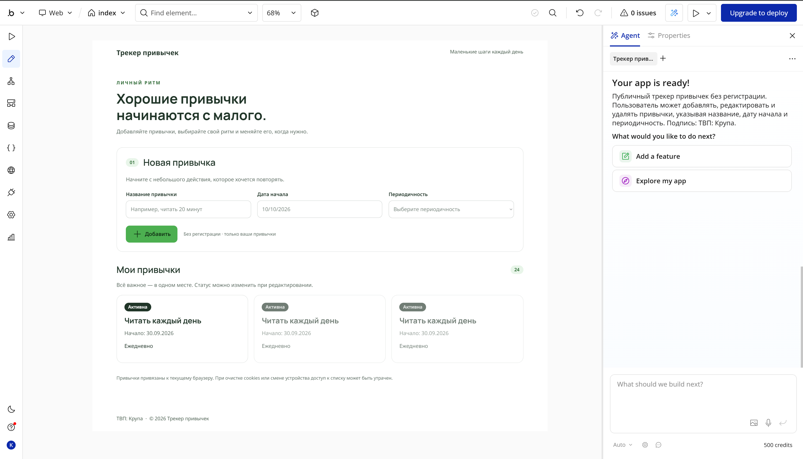

## 3. Часть 2. Исследование идеи

### 3.1. Что изучено

Изучены два курса в разделе Bubble Build Guides
(<https://bubble.io/home/buildguides>):

1. **«How to Build an AI app with Bubble»** — 1 раздел, 1 ч 30 мин
   (текстовая версия того же материала:
   <https://bubble.io/blog/build-gen-ai-recipe-app/>). В курсе показывается
   работа с AI-агентом прямо в редакторе: как сгенерировать каркас
   страницы, а затем доработать отдельные элементы руками — через панели
   `Visual`, `Layout` и `Conditional`.
2. **«Bubble Security Fundamentals: Protect Your App and Your Users»** —
   3 раздела, 15 мин. Про общую модель доступа: правила приватности
   (`Privacy rules`) на уровне Data Type, разграничение данных по
   `Current User` и безопасность условных переходов. Разделы курса:
   `Securing Your Bubble Account`, `Securing the Bubble editor`,
   `Securing Conditionals`.

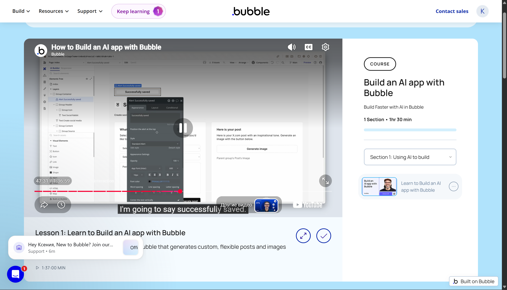

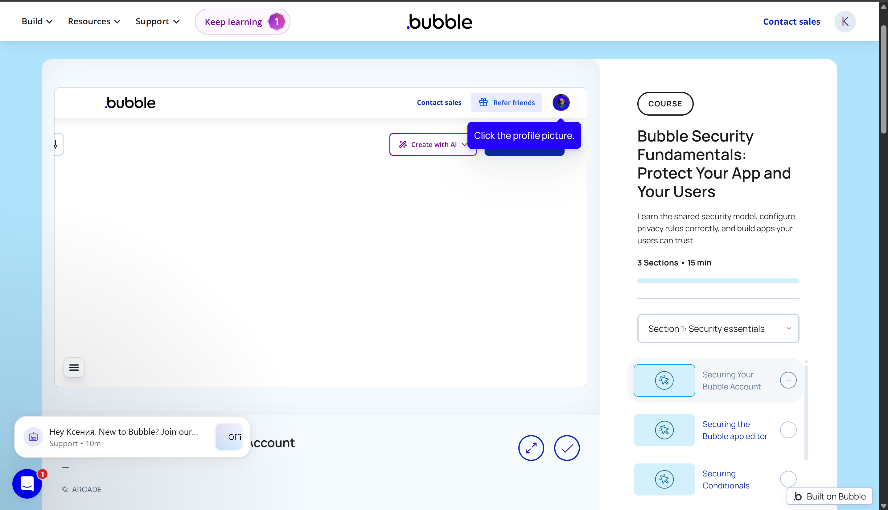

### 3.2. Что показалось полезным

* **AI даёт каркас, но не отделку.** Агент собирает структуру страницы и
  наполняет её осмысленными текстами, но цвета, отступы и повторяющиеся
  элементы всё равно приводятся к одному виду вручную. Это ровно то
  разделение, которое требуется в части 3 задания.
* **Работа с панелью элемента.** У каждого элемента настройки разложены по
  блокам `Appearance`, `Layout`, `Conditional`, а переменные (`Variables`)
  подключаются прямо в поле цвета — это пригодилось в части 4.2.
* **Правила приватности.** Без `Privacy rules` любой посетитель может
  вычитать данные через API, даже если в интерфейсе кнопок нет. Для
  публичного трекера привычек это существенно.
* **Порядок в редакторе.** В курсе по безопасности отдельно сказано, что в
  редакторе нужно держать только нужные права: для учебного проекта это
  значит не публиковать ключи и токены в репозитории.

### 3.3. Что взято в своё приложение

**Идея №1 — сводка по данным должна считаться, а не храниться.** В курсе
показывалось, что Bubble умеет вычислять значения прямо в текстовом
элементе по данным из базы, поэтому отдельное поле «сколько выполнено»
заводить не нужно. Идея применена так: над списком привычек стоит текстовый
счётчик «Всего привычек: 24, выполнено: 24» — значения берутся из базы через
количество записей, а не хранятся в поле.

**Идея №2 — список строить повторяющимся блоком, а не статичными карточками.**
Из разбора про список задач (<https://bubble.io/blog/build-to-do-list-app/>)
взята схема: карточки привычек выводятся повторяющимся блоком с источником
данных из базы, а кнопки внутри карточки работают с данными текущей ячейки.
Эта же схема использована на странице `checkins` для списка отметок.

**Идея №3 — из курса по безопасности:** у публичного приложения данные не
должны быть доступны на запись всем подряд, поэтому привычки не привязаны к
учётной записи и не содержат ничего личного.

### 3.4. Скриншоты «до» и «после»

**До** — в блоке «Мои привычки» только счётчик всех привычек, никакой
статистики по статусам:

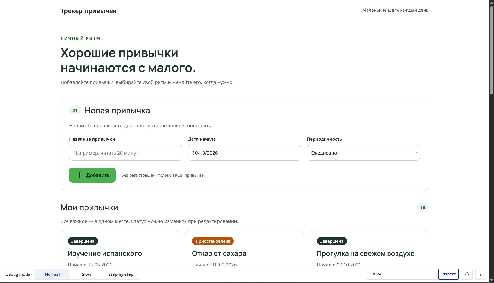

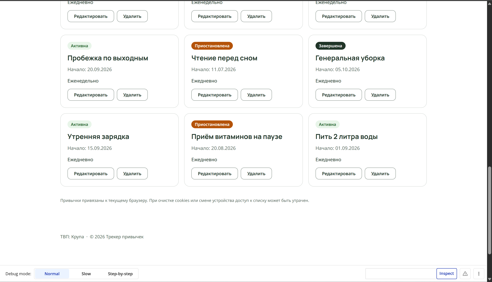

**После** — под заголовком появилась рассчитанная строка «Всего привычек:
18, выполнено: 6»:

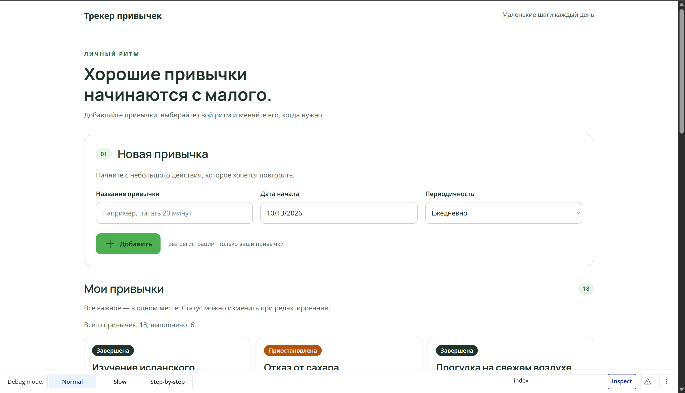

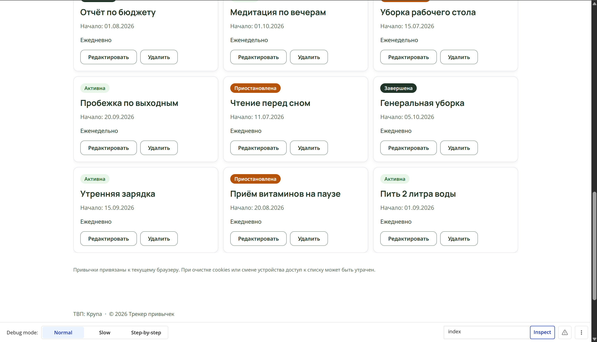

## 4. Часть 3. Ручная доработка UI

Всё в этой части сделано руками в редакторе Bubble, без AI-агента.

### 4.1. Текст заголовка

Требование пункта 3.1 — добавить в заголовок своё имя, фамилия уже есть из
промпта. Итоговый заголовок страницы `index` должен быть таким:

```
Хорошие привычки начинаются с малого. Ксения Крупа, ИИ-241
```

На скриншотах заголовок пока без имени и группы — правку нужно внести в
редакторе и снять скриншот заголовка (см. п. 11.2).

Правка, которая уже сделана: подпись под формой. Было «Без регистрации ·
только ваши привычки» — стало «только мои привычки», потому что список
привязан к браузеру, а не к чужой учётной записи.

### 4.2. Global variable для цвета

В разделе `Global` → `Variables` создана переменная типа **Color** с именем
`primary-color`. Значение — розовый `#de91ed`, тот же цвет, что был у
кнопки «Добавить» до этого. Затем переменная применена к элементу: у кнопки
«Добавить» в поле `Background` вместо жёсткого цвета выбрана переменная
`primary-color`.

На скриншоте видно, как палитра открывается прямо в панели элемента и
переменная `primary-color` выбирается из списка `Variables` — именно так
значение подставляется в элемент.

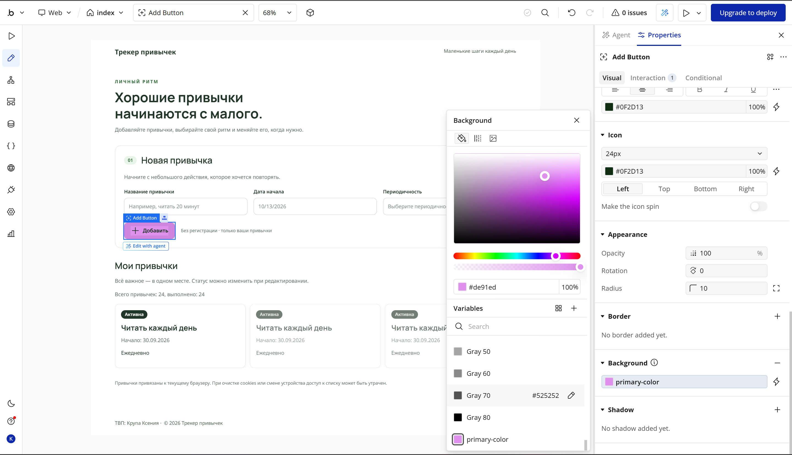

### 4.3. Свой стиль на основе переменной

Создан новый стиль `drop new` и применён к элементу `Freq Dropdown` — это
поле «Периодичность» в форме добавления привычки. В стиле заданы шрифт
`Noto Sans` 14 px, радиус скругления 10 px, поля ввода и рамка; цвет берётся
из переменной `primary-color`, поэтому смена переменной меняет вид поля
сразу. На скриншоте панель `Style` открыта у элемента, и в списке стилей
видно `drop new`.

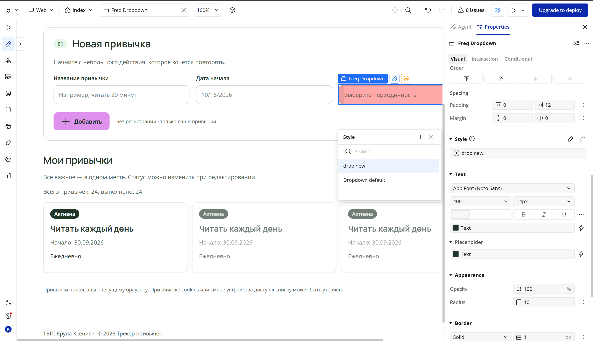

### 4.4. Готовый компонент

Из вкладки `Components` (Drag & drop UI components) на страницу `index`
перетащен готовый компонент — блок из трёх карточек преимуществ. Он
настроен под тему: заголовок «Почему это удобно» и три карточки «Просто»
(«добавьте привычку за пару секунд»), «Регулярно» («выберите периодичность
и дату начала») и «Наглядно» («следите за статусом: активна,
приостановлена, завершена»). На скриншоте в дереве элементов видно группу
`Features Group` с вложенными `Feature Просто Group`, `Feature Регулярно
Group` и `Feature Наглядно Group`.

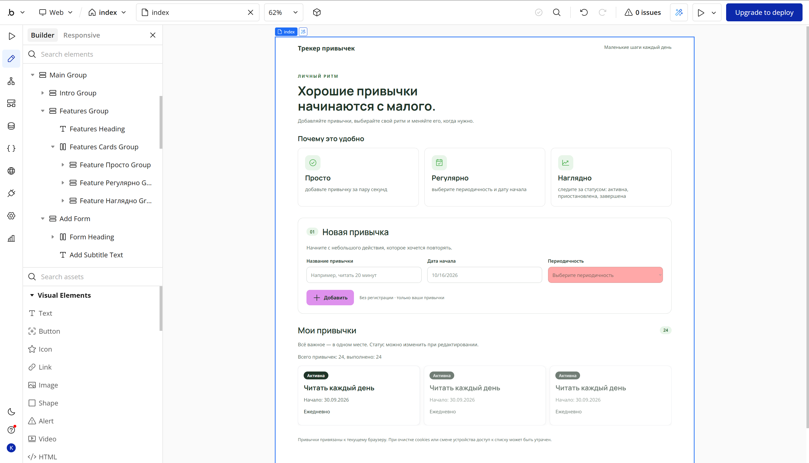

### 4.5. Карточки привычек

Список привычек сделан карточками: белый фон, скругление 12 px, тонкая
серая рамка, лёгкая тень, внутренние отступы 16 px и расстояние между
карточками 12 px. Оформление одинаковое для всех карточек, потому что
задано на уровне повторяющегося блока, а не у каждой карточки отдельно.

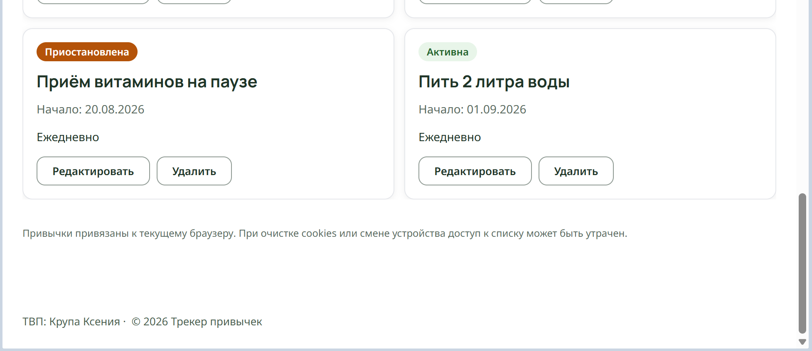

## 5. Часть 4. Data и Workflows

### 5.1. Сущность «Отметка выполнения»

Название и поля новой сущности предложены промптом (см. раздел 7), затем
созданы в `Data` → `Data types` → `New type`. Сущность называется
**«Отметка выполнения»**: одна привычка заводится один раз, а отмечается
она много раз, поэтому отметка — отдельная сущность со ссылкой на привычку.

| Поле | Тип | Обязательное | Смысл |
|---|---|---|---|
| `habit` | Привычка (ссылка) | да | к какой привычке относится |
| `check_date` | date | да | дата, за которую отмечаем |
| `is_done` | yes/no | нет | выполнено или нет |
| `note` | text | нет | короткая заметка |
| `rating` | number | нет | оценка дня от 1 до 5, добавлена под плагин Star Rating |

Четыре поля разных типов — дата, ссылка на другую сущность, да/нет и текст —
закрывают пункт 4.1 задания. Пятое поле `rating` добавлено позже, когда
появился плагин звёздного рейтинга (см. раздел 8).

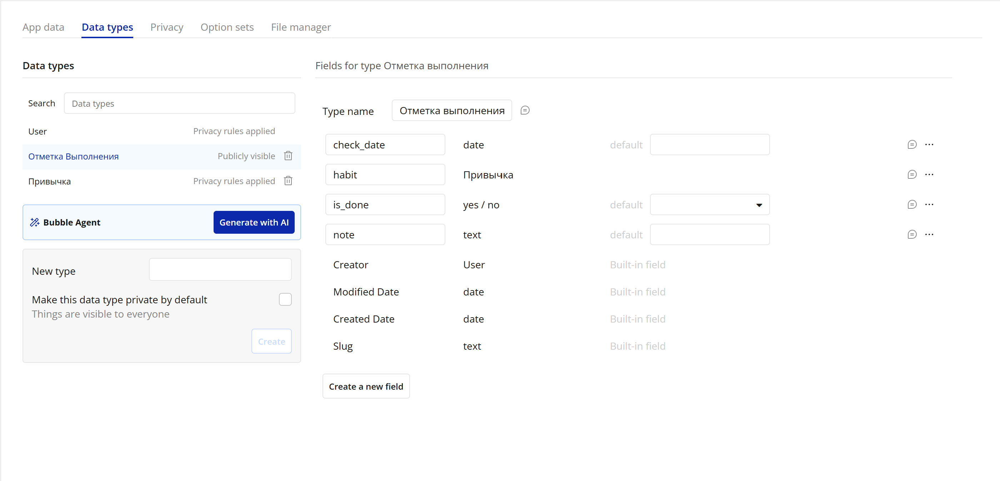

### 5.2. Записи

Три тестовые записи созданы вручную в Development через
`App data` → `New entry`. У записей разные даты и заметки, оценки — 5, 4 и
3, чтобы в интерфейсе было видно разное число звёзд.

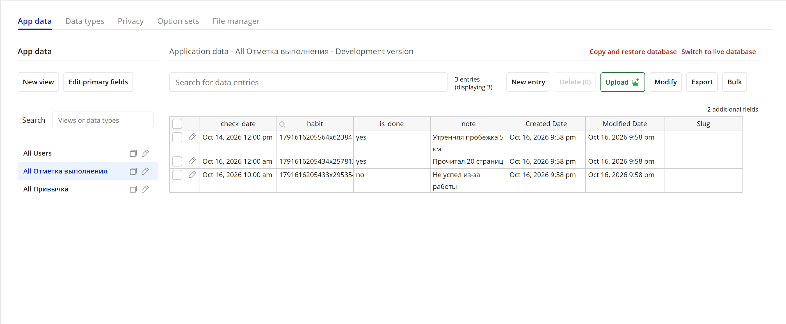

### 5.3. Страница checkins

Для CRUD создана отдельная страница `checkins` — «Отметки выполнения».
Страница публичная и оформлена в стиле приложения, подвал содержит
«ТВП: Крупа». Сверху форма добавления, ниже список всех отметок.

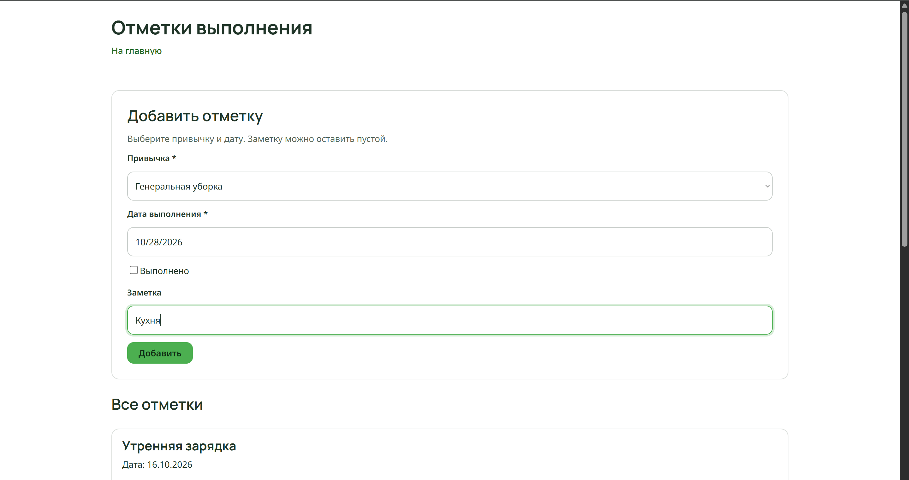

Workflow на странице — каждое действие сделано отдельным workflow, всего
семь:

| # | Workflow | Событие | Действия |
|---|---|---|---|
| 1 | `Создать отметку` | кнопка «Добавить» | `Create a new Отметка выполнения` → `Reset relevant inputs` |
| 2 | `Edit open edit` | кнопка «Редактировать» в карточке | открывает popup редактирования и заполняет поля значениями записи |
| 3 | `Edit save` | кнопка «Сохранить» в popup | `Make changes to Отметка выполнения` |
| 4 | `Edit cancel` | кнопка «Отмена» в popup | закрывает popup без изменений |
| 5 | `Del ask` | кнопка «Удалить» в карточке | открывает popup подтверждения |
| 6 | `Del cancel` | кнопка «Отмена» в подтверждении | закрывает подтверждение |
| 7 | `Del confirm` | кнопка «Удалить» в подтверждении | `Delete Отметка выполнения` |

### 5.4. Create

Триггер — нажатие кнопки «Добавить». Форма содержит выбор привычки, дату,
флажок «Выполнено», оценку дня звёздами и заметку; **привычка и дата
обязательны**, остальное можно не заполнять. Значения берутся прямо из
элементов формы:

```
Step 1: Create a new Отметка выполнения
        habit    = Habit Dropdown's value
        check_date = Date Date picker's value
        is_done  = Done Checkbox is checked
        note     = Note Input's value
Step 2: Reset relevant inputs
```

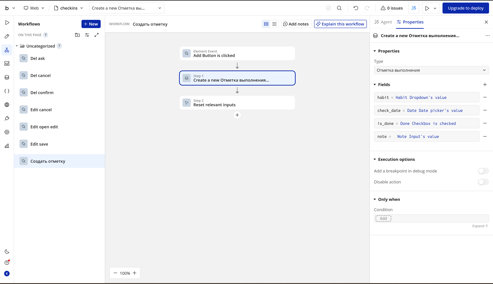

### 5.5. Read

Список «Все отметки» выводит записи из базы повторяющимся блоком с
источником данных `Search for Отметка выполнения`. Новые отметки
показываются сверху, то есть список отсортирован по дате по убыванию.

### 5.6. Update

Редактирование сделано через popup: кнопка «Редактировать» в карточке
открывает окно с уже заполненными полями, кнопка «Сохранить» меняет запись
(`Make changes to Отметка выполнения`), кнопка «Отмена» закрывает окно без
изменений.

### 5.7. Delete

Удаление — через popup подтверждения: сначала открывается диалог «Удалить
отметку? Отметка будет удалена без возможности восстановления», и только
кнопка «Удалить» в самом диалоге запускает удаление. Случайное нажатие по
карточке ничего не удаляет.

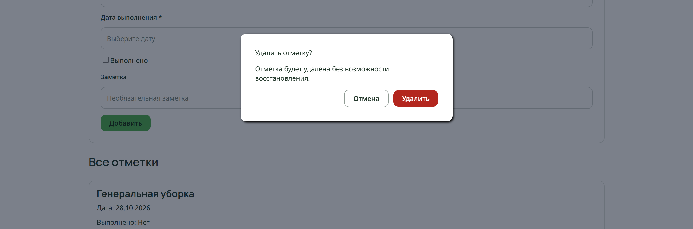

## 6. Часть 5. Ачивка 2 «Plugins»

### 6.1. Установленные плагины

| Плагин | Состояние | Что с ним стало |
|---|---|---|
| **Star Rating - PRO** | используется | элемент «Оценка дня» на 5 звёзд в форме и в карточках отметок |
| **Inspirational Quotes** | установлен, не используется | блок «Мотивация дня» добавлялся на `index`, но не заработал до конца; по просьбе преподавателя блок удалён со страницы, сам плагин остался установленным |

Ачивка защищается по **Star Rating - PRO**: у каждого студента свой плагин,
а этот не из тех, что показывались на лекции.

### 6.2. Star Rating - PRO

Плагин даёт элемент из пяти звёзд: пользователь выбирает оценку от 1 до 5,
значение элемента — число. В приложении он применён осмысленно: в трекере
привычек важно не только «сделал / не сделал», но и насколько хорошо
получилось.

* в форме на `checkins` добавлена «Оценка дня» — пять звёзд;
* выбранное значение сохраняется в поле `rating` (number) сущности
  «Отметка выполнения»;
* в карточках отметок звёзды показаны **только для чтения**, то есть
  показывают уже сохранённую оценку;
* у трёх тестовых записей оценки 5, 4 и 3 — видно, что значение хранится в
  базе, а не только в элементе.

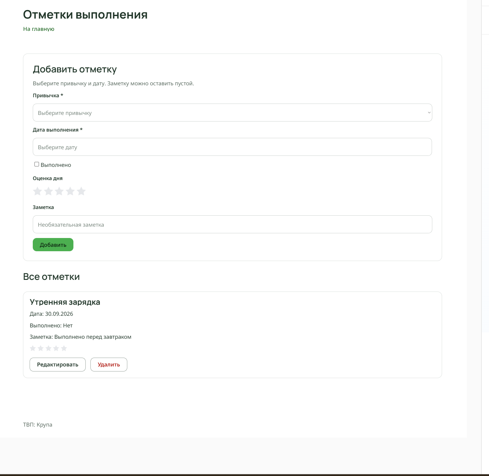

### 6.3. Настройки элемента

| Свойство | Значение | Почему так |
|---|---|---|
| количество звёзд | 5 | привычная пятибалльная шкала |
| значение по умолчанию | пусто | чтобы не записывать оценку «по умолчанию» случайно |
| цвет закрашенной звезды | из переменной `primary-color` | единый цвет приложения |
| размер | как у основного текста | чтобы не ломать сетку формы |

На защите показывается живое изменение свойства: например, количество звёзд
или цвет закрашивания — и объясняется, что при этом меняется в интерфейсе и
в сохранённых данных.

### 6.4. Известное ограничение

Звёзды в форме после добавления записи сами не сбрасываются: у плагина нет
действия сброса, а `Reset relevant inputs` очищает обычные поля ввода, но не
элемент плагина. Поэтому после создания отметки оценку приходится выставлять
заново вручную. Это ограничение самого плагина, а не ошибка workflow.

## 7. Использованные AI-промпты

Все промпты, которые использовались при работе, — дословно.

**Часть 1, генерация каркаса** (вставлен в AI-агента Bubble):

```
Создай приложение на тему «Трекер привычек»
Пусть этот сайт будет публичный, без регистрации
Страницу обязательно создай по структуре header + body + footer
Обязательно укажи в заготовке следующую строку: «ТВП: Крупа»
Добавь несколько интерактивных элементов (реализующих CRUD)
```

**Часть 4.1, сущность для Data** (промпт для генерации названия и полей
новой сущности):

```
Придумай сущность для отметки выполнения привычки. Привычка уже есть как
отдельный тип, отметок у одной привычки много. Нужно минимум 4 поля разных
типов: дата, ссылка на привычку, да/нет, текст. Дай таблицу: имя поля, тип,
обязательность, смысл. Предложи осмысленные имена полей для Bubble.
```

**Часть 4.2, UI страницы CRUD** (промпт AI-агенту Bubble):

```
Сгенерируй страницу «Отметки выполнения»: сверху форма добавления (выбор
привычки, дата, флажок «Выполнено», заметка), ниже блок «Все отметки» со
списком карточек, у каждой карточки кнопки «Редактировать» и «Удалить»
с подтверждением удаления. Не добавляй регистрацию.
```

**Часть 5, вопрос по работе плагина:**

```
Я добавил(а) на страницу элемент плагина «звёздный рейтинг». Объясни, что
такое значение элемента, какого оно типа и как сохранить это значение в
поле сущности при создании новой записи в workflow.
```

## 8. Что сгенерировал AI и что доработано руками

| Что | Источник |
|---|---|
| Структура `index`: header + body + footer, подпись «ТВП» | AI |
| Форма «Новая привычка» и карточки привычек на `index` | AI |
| Тексты заголовков и подписей | AI, потом правились вручную |
| Заголовок с именем и группой | вручную |
| Переменная `primary-color` и её применение к кнопке | вручную |
| Стиль `drop new` для поля «Периодичность» | вручную |
| Компонент «Почему это удобно» из `Components` | вручную, из готового компонента |
| Оформление карточек: скругление 12 px, рамка, тень, отступы 16 px | вручную |
| Сущность «Отметка выполнения» и её поля | AI предложил, создано вручную |
| Поле `rating` | вручную, под плагин |
| Страница `checkins` и семь workflow | AI сгенерировал UI, workflow собраны вручную |
| Плагин Star Rating - PRO и его настройки | вручную |
| Блок «Мотивация дня» (Inspirational Quotes) | добавлялся, не заработал, удалён |

## 9. Выводы

Bubble позволяет собрать приложение с базой данных и логикой вообще без
написания кода, но граница между «сгенерировано» и «доделано руками»
проходит не там, где ожидаешь. AI-агент за один промпт выдал готовую
страницу со структурой header + body + footer, формой и карточками
привычек — всю разметку и тексты. А вот всё, что касается единообразия,
пришлось делать вручную: одна переменная цвета, свой стиль на её основе,
готовый компонент из библиотеки и повторное применение к элементам.
Генерация экономит первый час работы, но не отменяет проектирования.

Самым непривычным после Node-RED из второй лабораторной оказался другой
подход к данным: в Bubble сущность объявляется один раз в `Data`, а потом
любой элемент страницы обращается к ней через `Search for`, и отдельного
кода для этого не нужно. При этом связи между сущностями (`Отметка
выполнения` → `Привычка`) и типы полей приходится продумывать заранее:
переделывать тип поля в Bubble дороже, чем добавить новое. Именно так
появилось поле `rating` — сначала была сущность без оценки, а потом под
плагин добавилось числовое поле, и workflow создания пришлось править.

Отдельный вывод — про отладку. В Bubble почти нет синтаксических ошибок,
зато есть ошибки логики: workflow собирается без ошибок в редакторе, но
может не сработать так, как ожидалось. Проверять нужно именно в `Preview`:
редактор показывает структуру, а не поведение. Это меняет привычку читать
код на привычку проверять каждый шаг в интерфейсе — и как раз этот шаг
самый трудоёмкий.

## 10. Соответствие структуре из задания

```
visual-programming-labs-Krupa/
├── README.md
└── lab3/
    ├── docs/
    │   ├── report.md          этот отчёт
    │   └── plan.md            рабочий чек-лист (не сдаётся вместо отчёта)
    └── screenshots/
        ├── 01-prompt.png
        ├── 02-buildguide-1.png … 02-buildguide-4b.png
        ├── 03-design.png, 03-global-variable.png
        ├── 04-style.png, 05-component.png
        ├── 06-data-type.png, 07-data-records.png
        ├── 08-workflow-create.png, 09-workflow-create.png, 10-workflow-delete.png
        └── 12-plugin.png
```

Скриншоты лежат в `lab3/screenshots/`, то есть **рядом** с `docs/`, а не
внутри неё. Поэтому в отчёте ссылки начинаются с `../screenshots/…`:
отчёт находится в `lab3/docs/`, и `..` поднимает на уровень `lab3`.

`api.md` не нужен: выбрана ачивка Plugins, а не API Connector.

## 11. Что осталось до защиты

Отчёт закрыт по всем частям, но два пункта нужно доделать перед защитой —
они честно перечислены здесь.

### 11.1. Проверить работу в Preview

Ни одна страница и ни один workflow не проверялись в браузере. Нужно
открыть `Preview` и убедиться, что:

1. на `index` список привычек и счётчик показывают данные;
2. на `checkins` создание отметки добавляет запись в список;
3. редактирование в popup сохраняет изменения;
4. удаление с подтверждением убирает запись;
5. оценка звёздами сохраняется и показывается в карточке.

### 11.2. Доснять скриншоты

| Файл | Что должно быть в кадре |
|---|---|
| `03-header.png` | заголовок `index` с именем и группой |
| `09b-workflow-read.png` | `Preview`: список отметок и открытая форма редактирования |
| `11-preview-*.png` | `Preview`: результат создания, изменения и удаления отметки |

### 11.3. Что ещё стоит закрыть

* заголовок на `index` должен содержать имя и группу (пункт 4.1);
* на защите быть готовой объяснить плагин Star Rating - PRO: его свойства,
  тип значения и что меняется при изменении настройки.
