# Лабораторная работа №4. n8n

**Выполнил:** Крупа Ксения, группа ИИ-241

## Часть 1. Установка и запуск n8n

- **Образ Docker:** `n8nio/n8n`
- **Порт:** `5678`
- **Volumes:**
  - `./lab4/n8n-data` → `/home/node/.n8n` — база n8n, настройки и ключ шифрования
  - `./lab4/data` → `/data` — вторая volume-папка для рабочих файлов
- **Прочие параметры:** `GENERIC_TIMEZONE=Europe/Moscow`, `TZ=Europe/Moscow`,
  `N8N_SECURE_COOKIE=false` (вход по http), `N8N_RUNNERS_ENABLED=true`,
  `--add-host=host.docker.internal:host-gateway` (чтобы n8n из контейнера видел
  Redis, запущенный на хосте)

**Команда запуска:**

```powershell
docker run -d --name n8n -p 5678:5678 -v "${PWD}\lab4\n8n-data:/home/node/.n8n" -v "${PWD}\lab4\data:/data" -e GENERIC_TIMEZONE="Europe/Moscow" -e TZ="Europe/Moscow" -e N8N_SECURE_COOKIE=false -e N8N_RUNNERS_ENABLED=true --add-host=host.docker.internal:host-gateway n8nio/n8n
```

### 1.1. Запуск редактора и версия

- **Задание:** установить n8n в Docker (порт 5678, два volume), открыть
  <http://localhost:5678> и зарегистрироваться.
- **Что делали:** запустили контейнер командой выше, зарегистрировали владельца,
  открыли Settings → Usage and plan.
- **Результат:** редактор работает, Community Edition, версия n8n — 2.44.6.

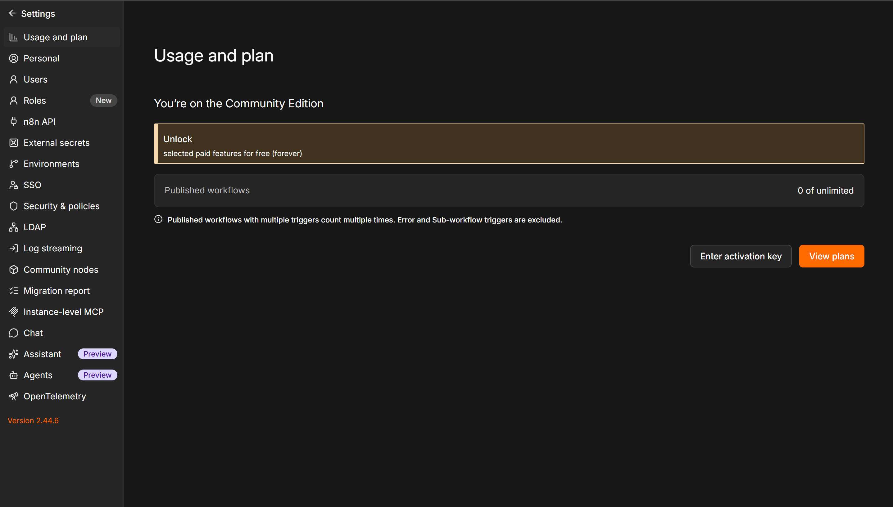

## Часть 2. Изучение нод и создание workflow

Были освоены и собраны следующие воркфлоу (все файлы лежат в папке `flows/`).
Запуск каждого — кнопкой **Execute workflow** (Manual Trigger).

| Пункт | Что собрано | Файл workflow |
|---|---|---|
| 2.1 | Manual Trigger → Set → Code | `flow-01-manual-set.json` |
| 2.2 | Manual Trigger → Code → NoOp | `flow-02-code.json` |
| 2.3 | Manual Trigger → Code → IF → NoOp (true/false) | `flow-03-if.json` |
| 2.4 | Manual Trigger → Set (topic, timestamp, payload) → Code | `flow-04-set.json` |
| 2.5 | Manual Trigger → HTTP Request → Code | `flow-05-http.json` |
| 2.6 | Schedule Trigger (каждые 5 минут) → Code | `flow-06-schedule.json` |

### 2.1. Manual Trigger → Set → Code

- **Задание:** собрать цепочку Manual Trigger → Set → Code; в Set задать
  `payload` = строка с фамилией и `topic = "lab4/<фамилия>/basic"`; в Code
  вывести полученные данные; задеплоить и выполнить вручную.
- **Что делали:** в Set задали `payload = "Krupa"` и `topic = "lab4/krupa/basic"`;
  в Code через `$input.all()` вывели оба поля в `console.log` и вернули те же
  items.
- **Результат:** все три ноды отработали, между ними по 1 item.

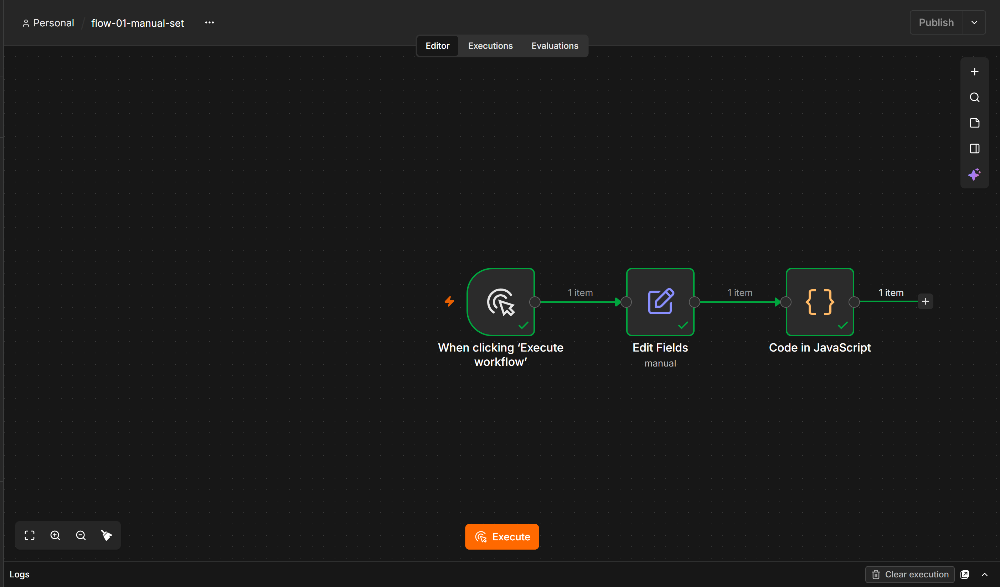

### 2.2. Code node

- **Задание:** Manual Trigger → Code → NoOp; в Code использовать `let`/`const`,
  `if`/`else`, цикл `for`, массив и объект; вернуть объект с полем `payload`.
- **Что делали:** циклом `for` прошли 5 итераций, на каждой дописали тег в массив
  `tags` (чёт/нечет через `if`/`else`) и собрали объект `result` с полями `user`,
  `group`, `items`; вернули `payload` с количеством обработанных элементов.
- **Результат:** `payload = "Krupa: processed 5 items (many)"`, дальше данные
  уходят в NoOp.

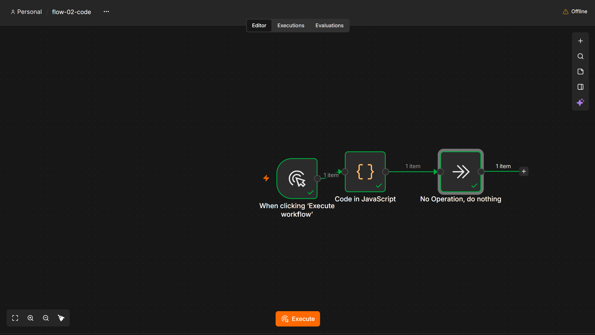

### 2.3. IF node

- **Задание:** Manual Trigger → Code → IF → (true) NoOp / (false) NoOp; в Code —
  логика, аналогичная 2.2; в IF настроить правило ветвления.
- **Что делали:** Code вернул тот же `payload` плюс числовое поле `score = 42`;
  в IF задали условие `$json.score > 10` (Number → greater than).
- **Результат:** данные ушли в ветку **true** (верхний NoOp с зелёной галочкой),
  ветка **false** не выполнялась.

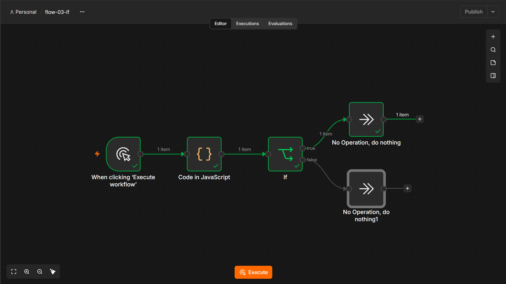

### 2.4. Set node (изменение полей, timestamp)

- **Задание:** Manual Trigger → Set → Code; в Set задать `topic`, `timestamp`
  (текущее время) и `payload`; в Code показать complete msg object.
- **Что делали:** в Set задали `topic = "lab4/krupa/set"`,
  `timestamp = {{ $now.toISO() }}` (текущее время запуска),
  `payload = "Krupa payload with timestamp"`; в Code собрали объект с полем
  `completeMsg` и вывели его в консоль.
- **Результат:** `Message on lab4/krupa/set at <ISO-время>: Krupa payload with timestamp`.

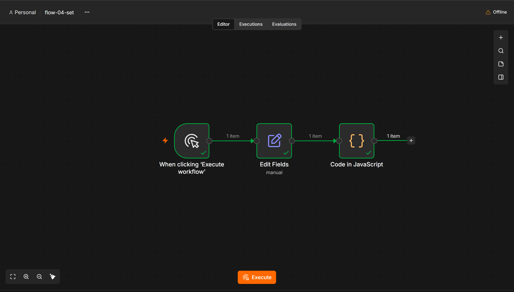

### 2.5. HTTP Request node

- **Задание:** Manual Trigger → HTTP Request → Code; любой публичный API без
  регистрации и токенов, метод GET, формат ответа JSON.
- **Что делали:** GET-запрос на `https://api.chucknorris.io/jokes/random`
  (формат ответа оставлен автоопределением — API возвращает JSON); в Code взяли
  первое поле ответа и вернули его как `fact`.
- **Результат:** шутка получена, в Code ушло поле `fact` с текстом.

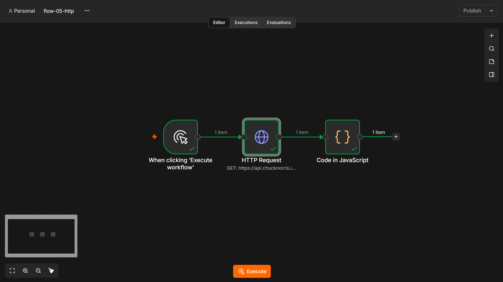

### 2.6. Schedule Trigger

- **Задание:** Schedule Trigger → Code; запуск каждые 5 минут (или раз в минуту
  для демонстрации); в Code вернуть текущее время.
- **Что делали:** в Schedule Trigger выбрали интервал в минутах (5 по умолчанию);
  Code возвращает `now` (ISO-время) и поясняющую строку `note`; для проверки
  выполнили workflow вручную.
- **Результат:** Code отдаёт текущее время, расписание настроено на каждые
  5 минут.

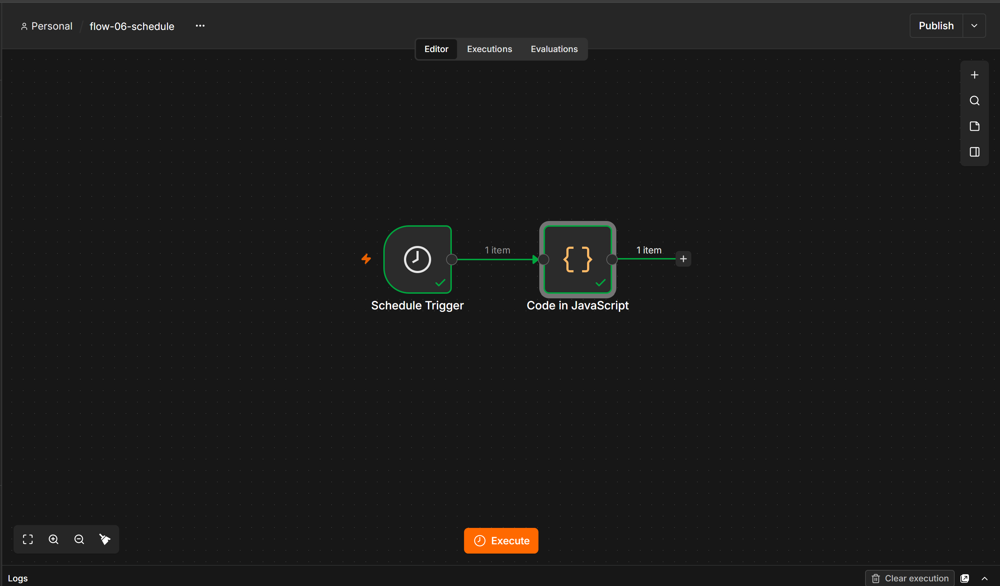

## Часть 3. Redis

Redis был запущен в Docker. В n8n настроены Credentials (`host.docker.internal`,
порт 6379). Подробности в [`redis.md`](redis.md).

### 3.1. Создание и чтение ключа (flow-09-redis)

- **Задание:** Manual Trigger → Redis (Set), ключ — фамилия латиницей, значение —
  произвольная строка → Redis (Get) прочитать этот ключ.
- **Что делали:** в Credentials указали `host.docker.internal:6379` без пароля;
  нода Redis (Set) пишет ключ `krupa` = `hello from Krupa`, вторая нода Redis
  (Get) читает его.
- **Результат:** Get вернул значение `hello from Krupa` (см. панель OUTPUT).

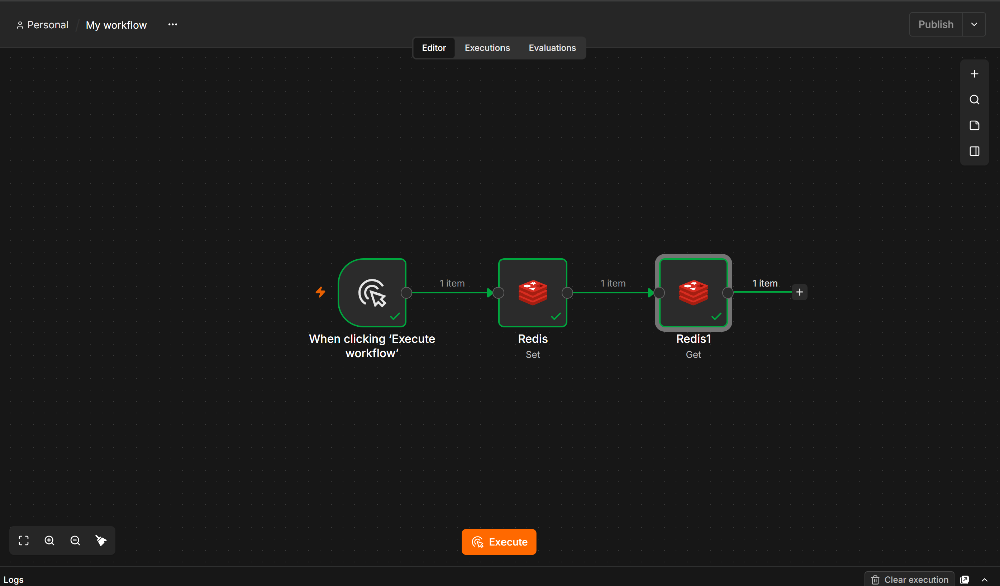

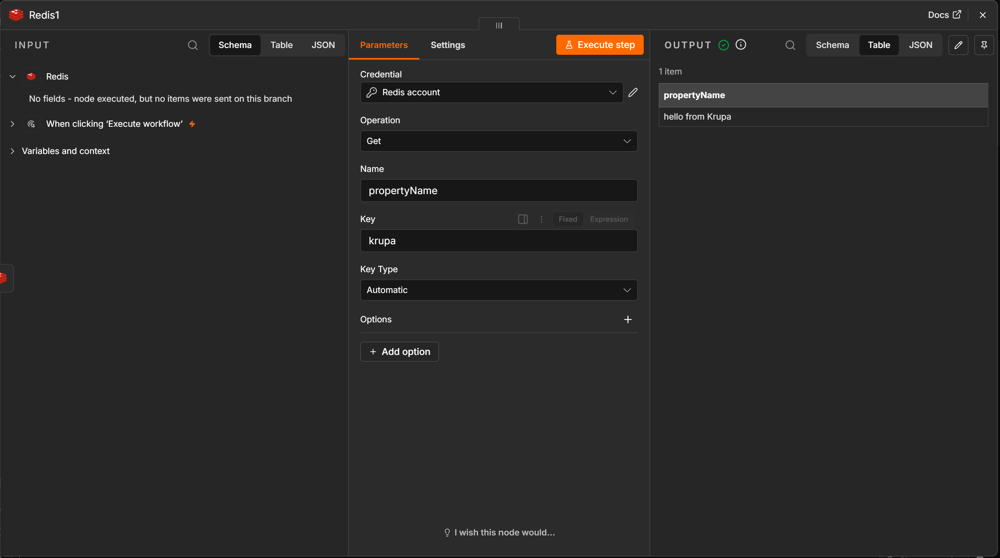

### 3.2. Удаление и проверка отсутствия (flow-10-redis)

- **Задание:** Manual Trigger → Redis (Delete) удалить ключ → проверить, что
  ключа больше нет.
- **Что делали:** нода Redis (Delete) удаляет ключ `krupa`, затем Redis (Get)
  читает его повторно. Отдельной операции Exists у ноды Redis в n8n нет, поэтому
  отсутствие проверяем через Get (и Keys по шаблону).
- **Результат:** Get вернул `null` — ключ удалён.

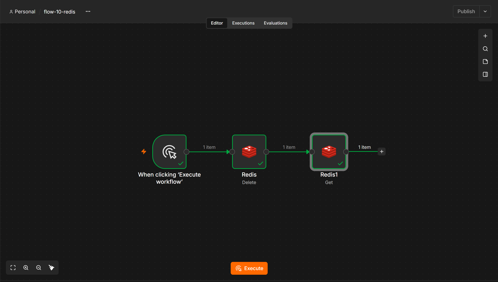

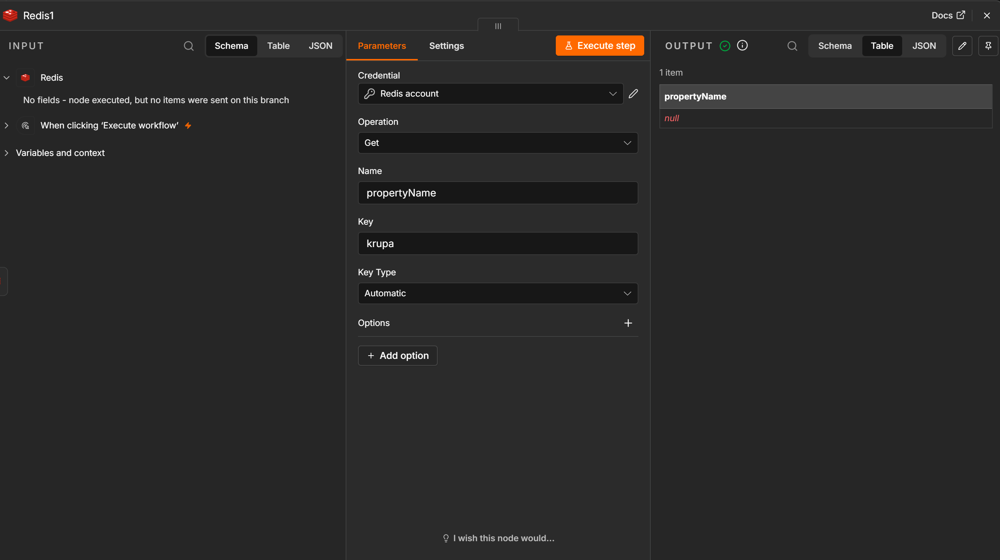

## Часть 4. Ачивка

**Выбрана Ачивка 5.2: Написать Rest API для работы с заметками (хранилище — Redis).**

Было реализовано два независимых воркфлоу, работающих как REST API. Оба
опубликованы (Published), поэтому доступны по production-URL.

### 4.1. POST — создание заметки (flow-11-achieve-rest-post)

- **Задание:** REST API для заметок: принимать заметку и сохранять её в Redis.
- **Что делали:** нода Webhook (POST, путь `notes`) принимает JSON; Redis (Set)
  пишет ключ `{{ $json.body.id }}` со значением `{{ $json.body.text }}`;
  Set формирует ответ `status: Created`.
- **Результат:** заметка сохраняется в Redis, клиент получает `status: Created`.

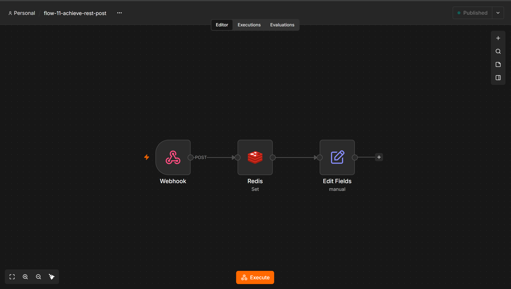

### 4.2. GET — чтение заметки (flow-12-achieve-rest-get)

- **Задание:** REST API для заметок: отдавать заметку по её id.
- **Что делали:** нода Webhook (GET, путь `notes`) берёт id из query-параметра;
  Redis (Get) читает ключ `{{ $json.query.id }}`; Set отдаёт поле `note` со
  значением `{{ $json.propertyName }}`.
- **Результат:** по `?id=note1` возвращается текст сохранённой заметки.

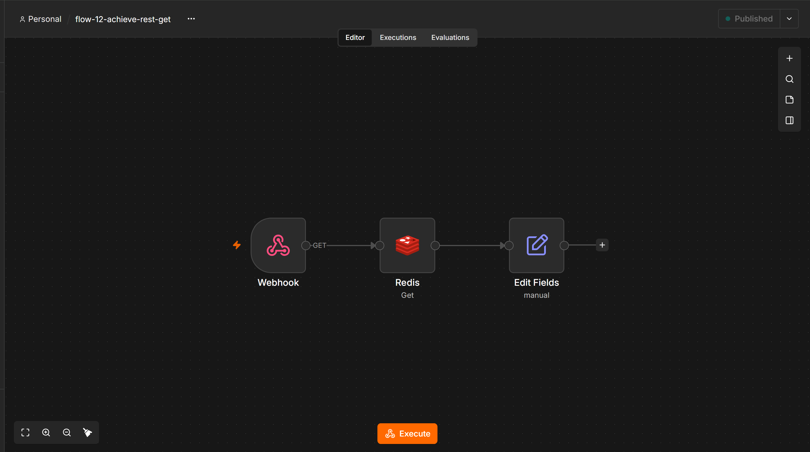

### 4.3. Проверка API из PowerShell

- **Задание:** показать, что REST API действительно работает.
- **Что делали:** два запроса `Invoke-RestMethod` — POST создаёт заметку
  `note1`, GET читает её по id.
- **Результат:** POST вернул `status: Created`, GET вернул
  `note: My first note in Redis`.

```powershell
Invoke-RestMethod -Uri "http://localhost:5678/webhook/notes" -Method Post -Body '{"id": "note1", "text": "My first note in Redis"}' -ContentType "application/json"
Invoke-RestMethod -Uri "http://localhost:5678/webhook/notes?id=note1" -Method Get
```

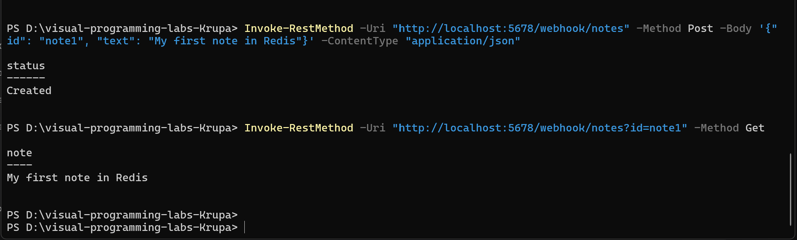

## AI-промпты

В ходе работы использовались следующие промпты:

1. «Напиши JavaScript код для ноды Code, который использует let, const, цикл for
   и возвращает объект с полем payload».
2. «Как настроить креденшелы для Redis в n8n, если Redis запущен в Docker на том
   же компьютере?»
3. «Как передать сообщение между двумя разными workflow в n8n с помощью Redis
   Pub/Sub?» (примечание: от этого варианта отказались в пользу REST API).
4. «Как создать REST API на нодах Webhook и Redis в n8n?»

## Выводы

В ходе лабораторной работы я освоила n8n как low-code платформу для
автоматизации. Научилась запускать её в Docker с сохранением данных через
volumes. Изучила базовые ноды (Set, Code, IF) и научилась писать простые скрипты
на JavaScript. Поняла, как работают HTTP-запросы и триггеры (Manual, Schedule).
Отдельно разобралась с настройкой внешней базы данных Redis: создавала, читала
и удаляла ключи. В качестве ачивки реализовала полноценный REST API для работы
с заметками (POST и GET запросы), используя Redis в качестве хранилища.
