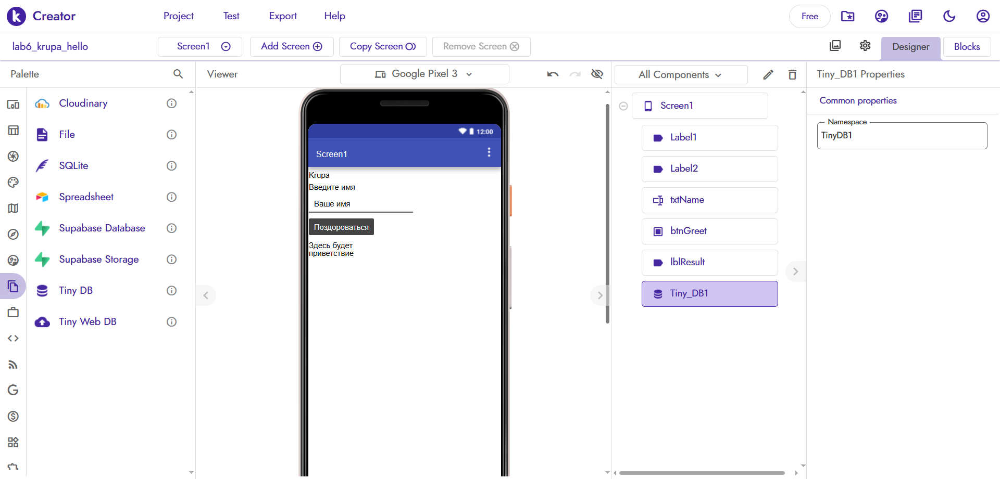
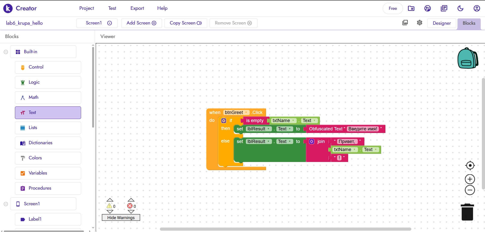
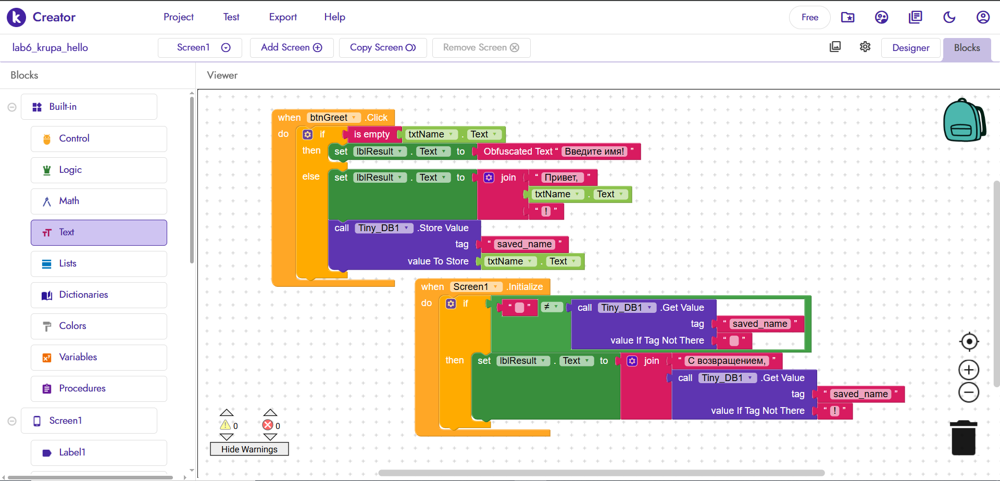

# Лабораторная работа №6. Kodular

**Фамилия:** Krupa
**Название проекта:** lab6_krupa_hello

---

## 1. Базовое задание (Приветствие)
**Что сделано:** 
Создан экран с полем ввода, кнопкой и текстом для вывода. На экране видна фамилия (Krupa). 
Реализована логика: если поле пустое, выводится ошибка «Введите имя!». Если имя введено, с помощью блока `join` формируется строка «Привет, <имя>!».

**Скриншот дизайна:**

**Скриншот блоков базовой логики:**

---

## 2. Ачивка 1: TinyDB (Сохранение имени)
**Что сделано:**
Использован компонент `TinyDB`. При нажатии на кнопку имя сохраняется в память телефона (тег `saved_name`). При повторном запуске приложения (Screen1.Initialize) программа проверяет память и, если имя там есть, автоматически здоровается: «С возвращением, <имя>!».

**Скриншот блоков Ачивки:**

---

## 3. Экспорт
Файл проекта `.aia` находится в папке `exports/lab6-krupa.aia`.

## 4. Ограничения бесплатного тарифа
Использован бесплатный тариф. Ограничения (до 10 проектов, до 10 МБ ассетов, до 5 расширений) не нарушены, так как в работе используется только 1 проект и нет сторонних расширений.