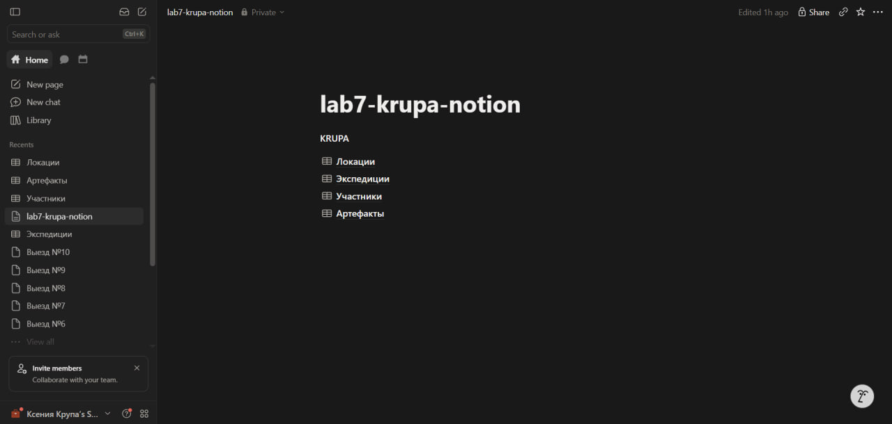
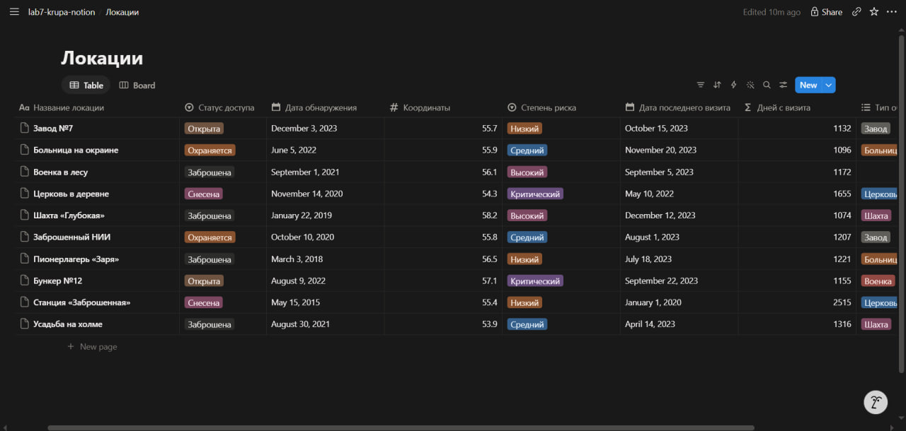
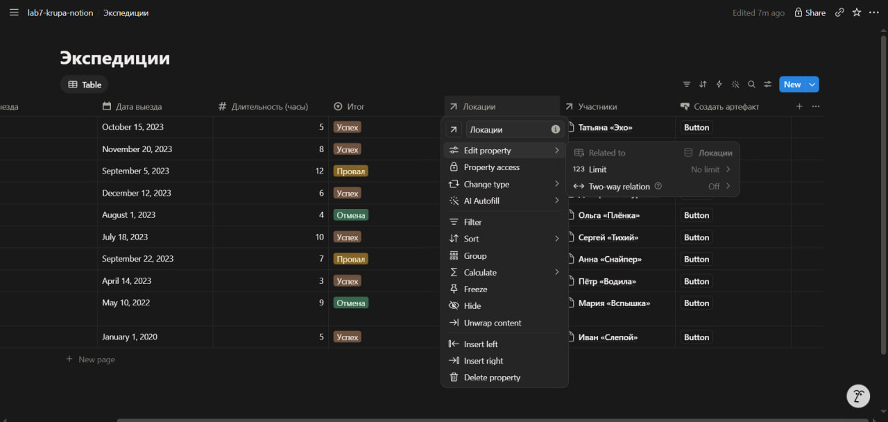
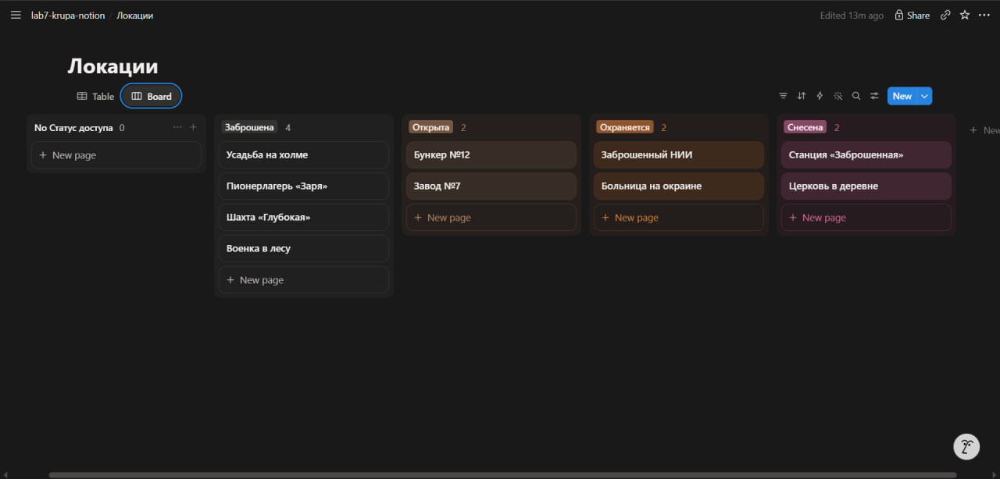
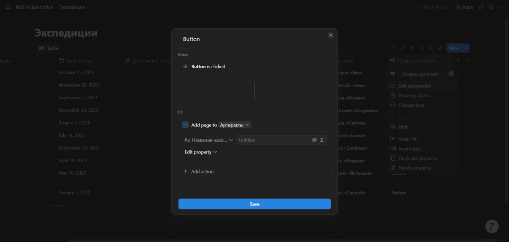
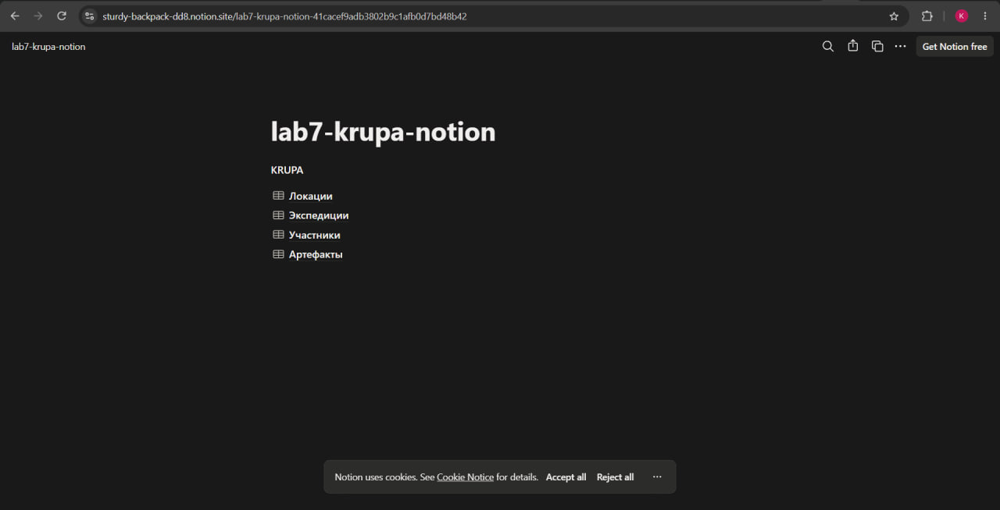

# Лабораторная работа №7. Notion

**Студент:** Krupa
**Ссылка на опубликованную страницу:** https://sturdy-backpack-dd8.notion.site/lab7-krupa-notion-41cacef9adb3802b9c1afb0d7bd48b42?source=copy_link

## 1. Предметная область и модель данных
**Предметная область:** «Экспедиции по заброшенным местам (урбан-эксплоринг)».

В ходе работы в Notion было создано 4 базы данных:
1. **Локации** — заброшенные объекты. 
   *Свойства:* Название (Title), Статус доступа (Select), Тип объекта (Multi-select), Дата обнаружения (Date), Координаты (Number), Степень риска (Select), Дата последнего визита (Date), Дней с визита (Formula).
2. **Экспедиции** — выезды команды. 
   *Свойства:* Название выезда (Title), Дата выезда (Date), Длительность (Number), Итог (Select), Стоимость (Formula), Локация (Relation), Участники (Relation).
3. **Участники** — люди команды. 
   *Свойства:* Имя (Title), Роль (Select), Дата вступления (Date), Стаж (Formula).
4. **Артефакты** — находки. 
   *Свойства:* Название (Title), Категория (Select), Дата находки (Date), Оценка редкости (Number), Ценность (Formula), Найдено в экспедиции (Relation), Локация (Relation).

**Связи (Relation):** 
Настроены 4 связи (двусторонние):
- Экспедиции ↔ Локации
- Экспедиции ↔ Участники
- Артефакты ↔ Экспедиции
- Артефакты ↔ Локации

*Скриншот 1: Главная страница с видимой фамилией.*

## 2. Промпт для ИИ и что исправлено
**Промпт:**
> «Придумай уникальную предметную область для учебного проекта в Notion (не бери банальные задачи, книги или рецепты). Нужно 4 сущности: одна главная и три связанные. Минимум 2 связи Relation. Свойства: Title, Select/Multi-select, Date, Number, Relation, Formula. Дай список сущностей, их свойств и опиши, какие связи между ними. В одной сущности должна быть формула (например, разница дат или умножение), в другой — кнопка для создания записи в связанной базе».

**Ответ ИИ:** ИИ сгенерировал модель данных «Экспедиции по заброшенным местам» с таблицами Локации, Экспедиции, Участники, Артефакты и связями 1:N и M:N. Также ИИ предложил формулы для расчета дней и стоимости.

**Что исправлено после проверки:** 
- Упрощена формула в «Локациях»: вместо сложного Rollup-свойства использовано базовое Date-свойство «Дата последнего визита» для расчета дней через Formula.
- Для кнопки выбрано базовое действие «Add page to» (создание записи), чтобы избежать ограничений бесплатного тарифа.

## 3. Реализованные настройки Notion
- Создано 4 базы данных, в каждую добавлено более 10 записей.
- Настроены 4 связи типа Relation (с включенной обратной связью).

*Скриншот 2: Заполненная таблица с данными.*

*Скриншот 3: Настройка связи между таблицами.*

- В таблице «Экспедиции» настроены **два представления**: Table (таблица) и Board (канбан с группировкой по полю «Итог»).

*Скриншот 4: Канбан (Board) в экспедициях.*

- Реализованы формулы (Formula):
  - В «Локациях»: `dateBetween(now(), prop("Дата последнего визита"), "days")`.
  - В «Экспедициях»: `prop("Длительность (часы)") * 500`.
  - В «Участниках»: `dateBetween(now(), prop("Дата вступления"), "days")`.
- Добавлена кнопка (Button) в таблице «Экспедиции», которая выполняет действие «Add page to» и создает связанную запись в базе «Артефакты».

*Скриншот 5: Настройка кнопки (Button).*

- Главная страница опубликована в веб (Share → Publish to web).

*Скриншот 6: Опубликованная страница в браузере.*

## 4. Ключевые AI-промпты
1. Промпт для генерации предметной области и списка сущностей (приведен в п.2).
2. Промпт для генерации формул: «Напиши формулу для Notion, которая считает количество дней с указанной даты до сегодняшнего дня».
3. Промпт для настройки связей: «Как в Notion сделать двустороннюю связь между таблицами?».

## 5. Освоенные компоненты Notion
- Создание страниц и баз данных (Full page database).
- Настройка типов свойств: Title, Select, Multi-select, Date, Number, Relation, Formula, Button.
- Настройка связей Relation (включая двусторонние).
- Создание и переключение представлений (Table, Board).
- Написание формул.
- Настройка автоматизации через кнопки (Button).
- Публикация страницы в веб (Publish to web).

## 6. Ограничения бесплатного тарифа Notion
Существенных ограничений не возникло. Работа велась в личном воркспейсе, лимит на количество блоков не был превышен, интеграции с внешними сервисами не требовались.

## 7. Выводы
В ходе лабораторной работы я освоила базовые и продвинутые возможности Notion как low-code платформы. Я научилась создавать базы данных, настраивать связи между ними через Relation, использовать формулы для вычислений (например, расчет дней или стоимости) и кнопки для автоматизации создания записей. Notion позволяет быстро создавать удобные системы управления проектами без написания кода. Также я разобралась, как публиковать проект в интернете.